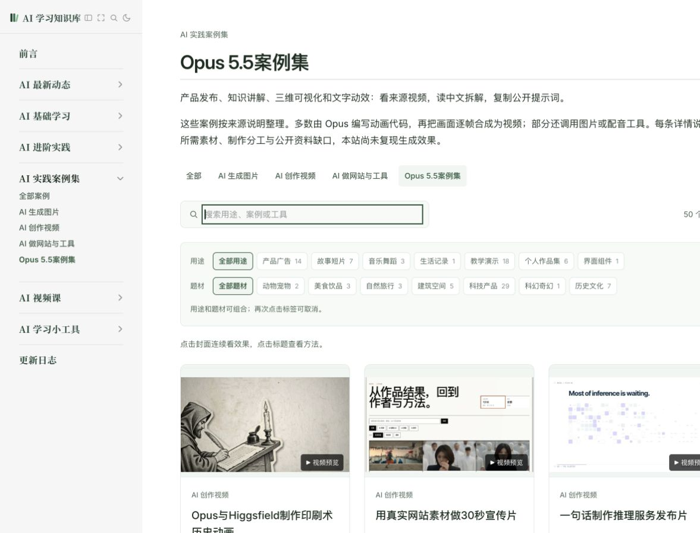

# 测试报告 · Opus 5.5案例集扩至50例 · 2026-10-13

## 测试环境
- macOS，Codex 内置浏览器；桌面1280×900、手机390×844模拟尺寸。未在真实微信或多款手机浏览器中测试。
- 本地生产构建：`npm run docs:build`通过；57项自动测试、599个案例、820个HTML页面的链接与资源检查通过。
- 发布基线：`d10f4ae284f3816dc761efc5a291178857aeddf4`（v1.76）。

## 测试用例

| # | 测试场景 | 操作步骤 | 预期结果 | 实际结果 | 状态 |
|---|---|---|---|---|---|
| 1 | 数量与旧内容 | 基线增量校验，逐页加载列表 | 专题50，全库599；仅新增34个视频 | 旧565条数据、顺序、指纹、标签保留；分页12→24→36→48→50 | 通过 |
| 2 | 原文与来源 | 对照来源缓存、原文指纹、作者和收录链接 | 完整公开原文保留，作者与合集分开 | 新增30条JasonZhu.AI、4条apimodels；34个独立作品标识 | 通过 |
| 3 | 视频与封面 | 每条读取媒体元数据，逐张查看代表帧 | 来源可读取，封面有辨认内容 | 34个独立视频可读取，34张本地封面逐张检查 | 通过 |
| 4 | 搜索与返回 | 搜索金阁寺、递归；进入详情后返回 | 只显示匹配案例并保留专题条件 | 金阁寺1条；返回保留专题和搜索词 | 通过 |
| 5 | 完整复制 | 金阁寺中分别复制中文和作者原文 | 复制包含全部内容 | 中文494字符、原文668字符，与展示内容一致 | 通过 |
| 6 | 笔记下载 | 下载金阁寺与递归笔记，读取文件 | 中文、原文与准确署名 | 两份完整；分别署名JasonZhu.AI、apimodels；递归无错误Goodcase署名 | 通过 |
| 7 | 手机排版与筛选 | 390×844下选择教学演示，再选择科技产品 | 标签取交集，不溢出 | 教学18条，交集8条；页面宽度未超390，封面无损坏 | 通过 |
| 8 | 连续浏览 | 点餐视频播放后结束；打开全专题并前后切换 | 只在50条内切换，关闭停止播放 | 点餐16.256秒播放至结束；下一条第11/50，回退与关闭正常 | 通过 |
| 9 | 本地新增视频播放 | 高能动效重试，金阁寺/递归详情抽查 | 来源视频播放 | 本地嵌入受源站请求限制；高能动效直接打开播放至15.061秒结束 | 受环境限制 |
| 10 | 正式地址请求核对 | 同一视频携带本地和正式地址分别读取1KB | 正式地址可获取视频 | 本地Referer返回403；正式地址Referer返回206、video/mp4 | 通过 |
| 11 | 构建与回归 | 生产构建、测试、案例、资源、链接与差异检查 | 无失败或缺失资源 | 57项测试、599案例、820HTML及差异检查全部通过 | 通过 |

## 发现的问题与处理
- 游戏候选属于交互游戏而非本专题视频，已换成代码配乐短片。
- 沙画候选在两个时间点缺少可辨认内容，已换成“过度思考”主题动效。
- 新来源不应统一署名Goodcase；已补来源名与域名/路径校验，列表、原文提示、详情和下载准确显示各自来源。
- 新视频源站拒绝带`http://127.0.0.1:5183/`的嵌入请求，正式站点地址请求正常。线上发布后需在正式网址验收实际播放，不以元数据读取代替播放。

## 遗留风险与验证边界
- 视频、模型身份与制作分工依据公开来源说明；34条均为`tested:false`，未调用付费模型复现生成。
- 代表帧与元数据检查覆盖全部新增视频；不表示34条都逐秒看完或所有设备均可播放。外部视频由源站提供，访问条件可能变化。
- 部分提示词依赖上传素材、前文或工程文件；缺口已在准备说明中标出，未补造作者材料。

## 验收清单
- [x] 专题50例、新增34例、旧内容完整。
- [x] 中文说明、公开原文、练习、来源和本地封面完整。
- [x] 桌面搜索、复制、下载和专题浏览通过。
- [x] 手机模拟尺寸与组合筛选通过。
- [x] 生产构建与必需检查通过。
- 线上部署与正式网址播放在发布后另行核实，记录于本地发布验证档案。

