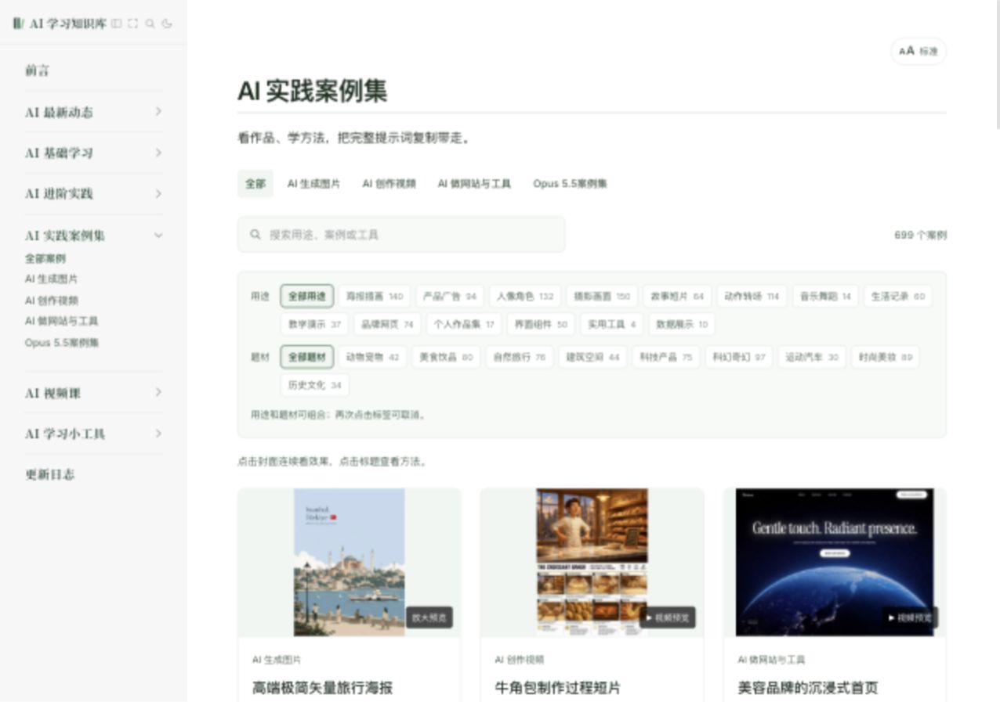
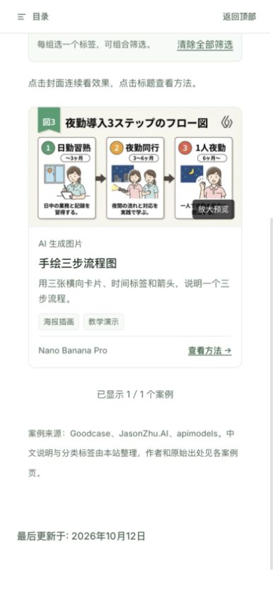

# 测试报告 · AI 实践案例集新增 100 个 · 2026-11-03

用户要求新增 100 个案例。本批已完成本地整理与验收，累计 699 个；William 于 2026-11-03 确认发布。本报告记录发布前的本地检查，线上结果另行核对。沿用原有三类入口、浏览方式和 50/30/20 分配，不新增功能或专题入口。

| 分类 | 原有 | 新增 | 累计 |
| --- | ---: | ---: | ---: |
| AI 生成图片 | 225 | 50 | 275 |
| AI 创作视频 | 284 | 30 | 314 |
| AI 做网站与工具 | 90 | 20 | 110 |
| 合计 | 599 | 100 | 699 |

## 本批内容

- 100 条均取自 [Goodcase](https://goodcase.ai/) 公开详情，重新取得完整公开原文，保留作者、原始出处、收录地址、媒体及原文 SHA-256。没有把预览补写为作者全文。
- 每条新增中文标题、摘要、准备材料、三条具体操作与检查、学习点、练习及用途/题材标签。作者原文与本站建议分开；没有调用生成工具复现作品，全部保留 `tested: false` 与页面提示。
- 图标集、三步流程、双栏食谱、角色动作表四条实际为日文，新增完整中文译文；保留需替换的变量，解释输出图中文字的语言要求。
- 标出来源未附的输入分镜、人物参考、标志或 GLB 模型；广告参数、尺寸与输出规格是作者目标，不写成平台保证。原文烤盘与成品形状不一致、信息图详略冲突等问题就近说明。
- 100 张新增本地 JPEG 封面，可解码，总计约 4.5 MiB。部分分享长图裁去提示词文字区用于列表展示；香水黑帧封面改为视频第 4 秒。作者原始效果媒体未修改。
- 排除截断提示词、只介绍流程未公开实际提示词、展示为建站平台宣传而非目标作品、媒体获取不稳定及重复媒体的候选。一次去重发现两条不同原文共用同一效果图，已替换；最终新增来源帖子与媒体均不重复。

## 测试环境

- 本地正式生产构建，Node v22；线上工作流为 Node 20，本轮未触发远端部署。
- Codex 内置浏览器，1280 × 900 桌面及 390 × 844 手机尺寸。
- 预览：<http://127.0.0.1:5178/cases/>。
- 旧库固定基线：`7db0b9e0144ee7b5a3de95879558d66e177aab8a`。本地先快进同步远端的日报与榜单提交，再开展增量整理。

## 测试用例

| # | 场景 | 验证方法 | 实际结果 | 状态 |
| --- | --- | --- | --- | --- |
| 1 | 正式构建 | `npm run docs:build` | 64 项测试通过；699 个案例与 943 页站内链接、资源、锚点检查通过 | 通过 |
| 2 | 增量及分类 | 固定 Git 基线与工作区比较，显式预期新增 100 和 50/30/20 | 599 → 699；旧完整数据与顺序保持 | 通过 |
| 3 | 旧页面、封面与标签 | 旧跟踪文件差异检查；599 条标签逐条比较 | 旧详情、旧封面无差异；旧标签保持 | 通过 |
| 4 | 来源字段 | 100 条对照本批重新获取的来源快照 | 作者、两类出处、原文、媒体地址与类型完全一致 | 通过 |
| 5 | 去重 | 比较 slug、规范化原文、原始帖子及媒体 URL | 新增互不重复，也不重复旧库 | 通过 |
| 6 | 本地封面 | 100 张逐项解码、联系表目视复核、含糊图单独复核 | 100 张存在且可读取；无额外未采用封面混入本批 | 通过 |
| 7 | 媒体信息 | 读取新增视频及网页演示的媒体信息 | 43/43 可读取时长、编码及画幅；含 30 条视频案例和 13 条网页演示 | 通过 |
| 8 | 视频实际播放 | 在香水新案例点击播放，读取结束状态 | 实际播放至 19.156009 秒结束，`readyState=4`，无媒体错误 | 通过 |
| 9 | 新案例搜索 | 搜索“手绘 三步”及完整标题 | 前者包含旧例与新增例；完整标题只匹配新增一条 | 通过 |
| 10 | 分页 | 总列表点击“再看 12 个案例” | 12/699 → 24/699 | 通过 |
| 11 | 筛选连续浏览 | 从搜索结果进入新流程图详情 | 保留当前筛选，显示 2/2；返回链接保留查询条件 | 通过 |
| 12 | 中文复制 | 点击复制并比较剪贴板与完整显示文本 | 898 字符完全相同，不受折叠影响 | 通过 |
| 13 | 原文切换与复制 | 切换作者原文，再复制对比 | 1408 字符日文原文完全相同，作者说明正确 | 通过 |
| 14 | 下载笔记 | 实际下载并读取文件 | 2778 字符，含完整中文与日文、操作、学习点、练习及两类出处 | 通过 |
| 15 | 大图预览 | 搜索完整标题后点封面 | 弹层显示 1/1，边界按钮禁用，可关闭 | 通过 |
| 16 | 手机尺寸 | 检查新增图标详情与列表 | 390 宽时页面 386，无横向溢出；来源图成功加载 | 通过 |
| 17 | 桌面尺寸 | 总列表与新增流程图详情 | 1280 宽时页面 1276，布局可读 | 通过 |
| 18 | 范围与空白 | `git diff --check`、差异检查 | 未改脚本、主题、部署配置、base、CNAME 或素材库 | 通过 |

## 结果边界

- 媒体信息检查不代表所有视频均已完整播放；本轮完整播放验证为一个代表样例。远程视频与原图以后仍可能失效，列表封面已保存在本地。
- 桌面及手机尺寸检查使用同一内置浏览器，没有替代真实微信、Safari、手机设备验收。
- 未逐条重新制作作品，未支付生成费用；公开提示词与参考材料缺口已如实保留和说明。
- 来源依据为 Goodcase 公开详情；没有宣称逐条独立核实全部 X 原帖或作者模型归因。
- 构建仍有既有的超过 500 kB 代码包提示，构建成功。本批未做框架或功能改造。
- 两份更新日志已准备，版本为 v1.83；正式域名的数量、媒体和部署结果在发布后核对。

## 验收入口

- [全部案例，本地 699 例](http://127.0.0.1:5178/cases/)
- [新增手绘三步流程图](http://127.0.0.1:5178/cases/3-slides-18e4f701fd60)
- [新增可下载 SVG 图标集](http://127.0.0.1:5178/cases/40-svg-5229d1feb246)
- [新增暗蓝香水瓶广告](http://127.0.0.1:5178/cases/seedance-cinematic-19-second-commercial-ad-for-a-luxury-perfume-142bf48ed0d2)

- [x] William 确认本批选题与中文说明。
- [x] William 于 2026-11-03 确认正式发布。
- [ ] 发布后核对 GitHub Actions 与正式网站 699 例及代表媒体。

